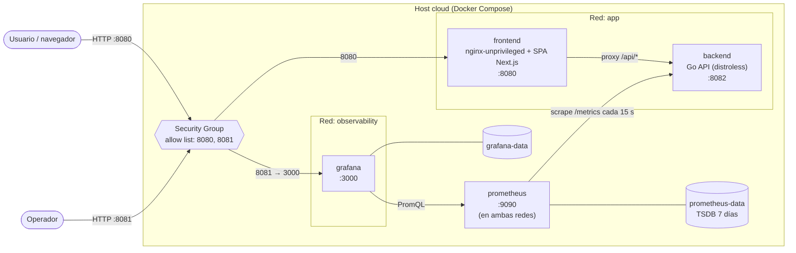
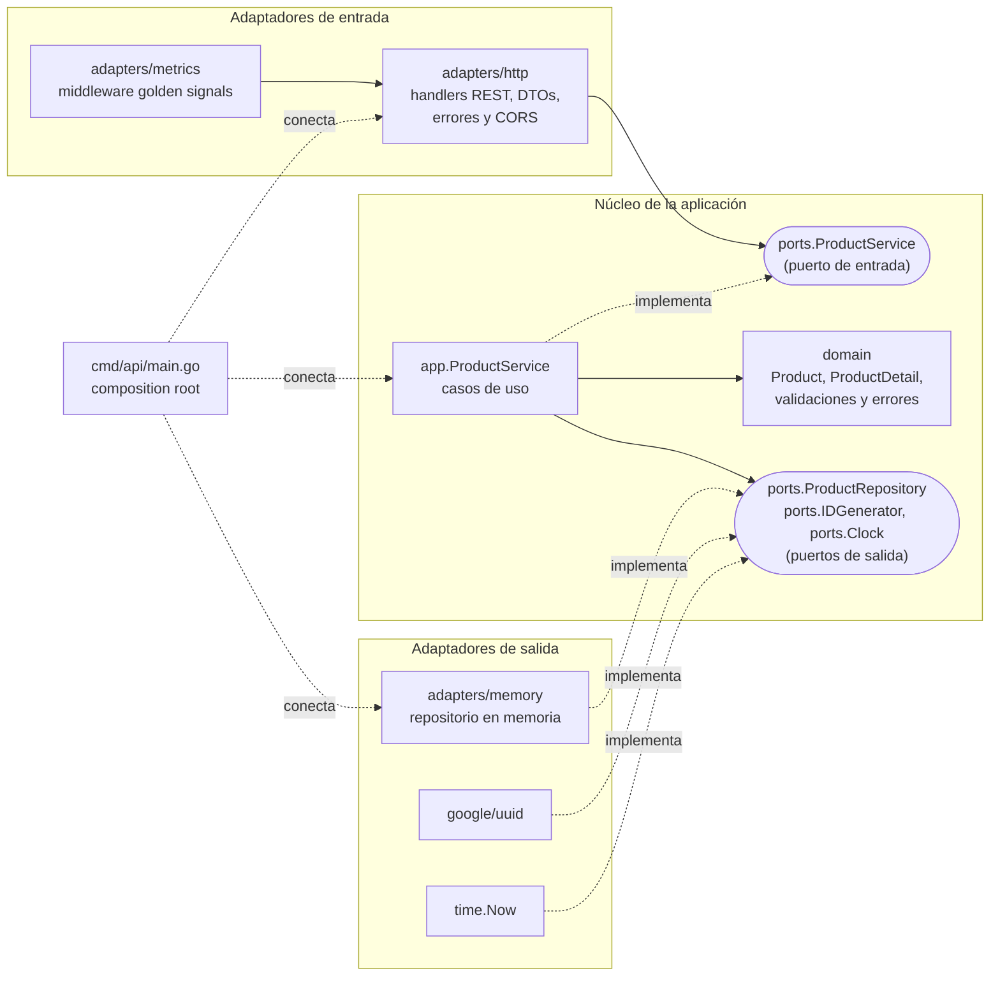
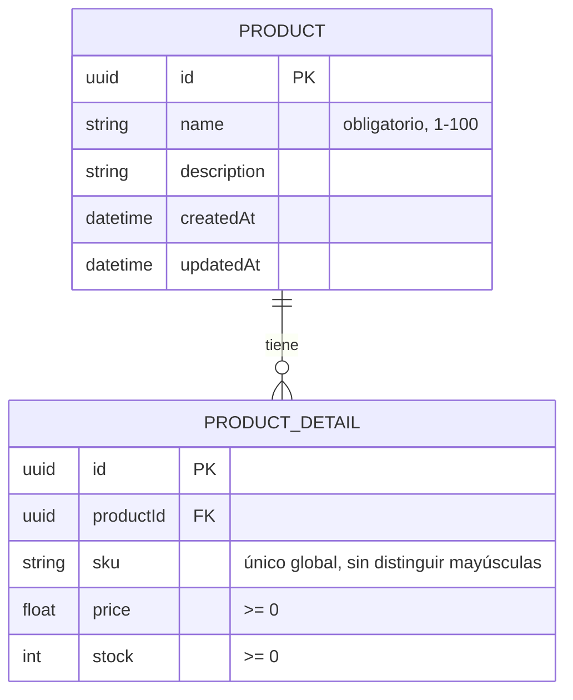
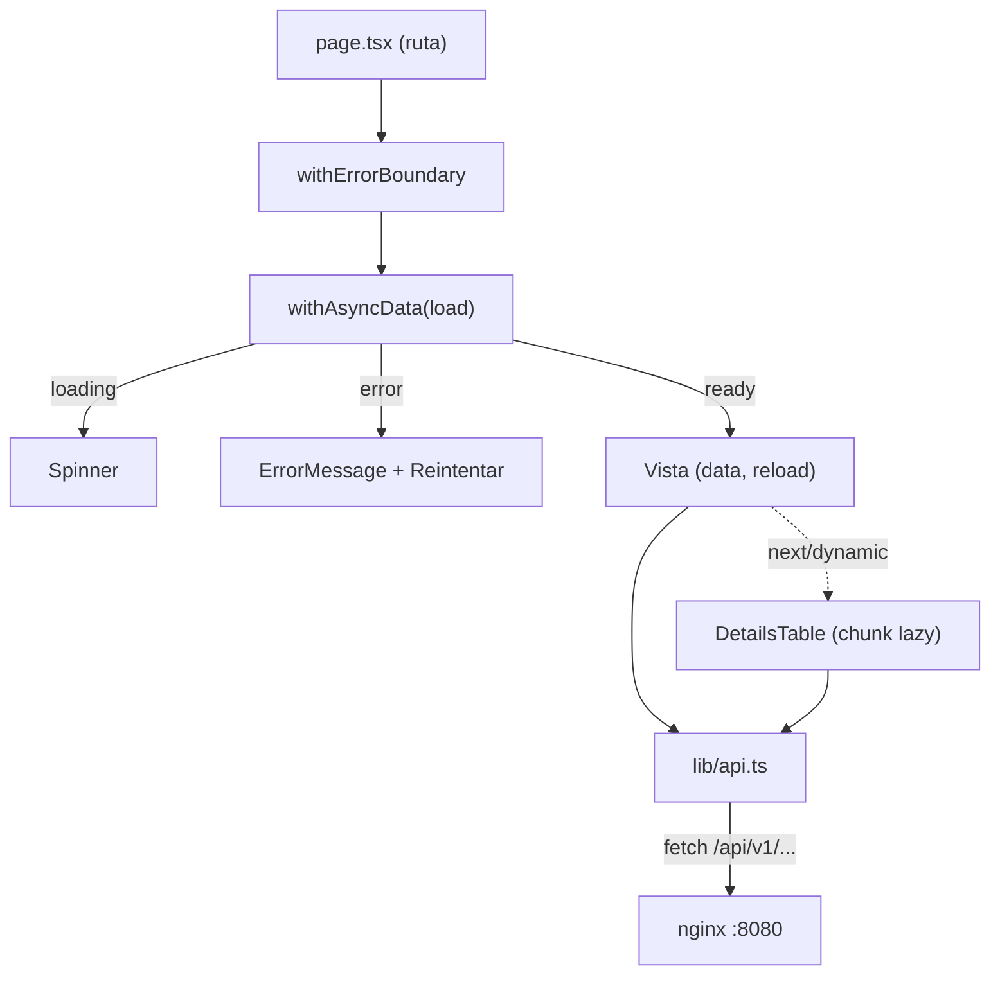
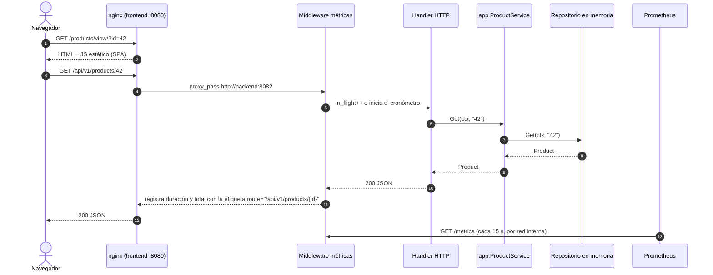
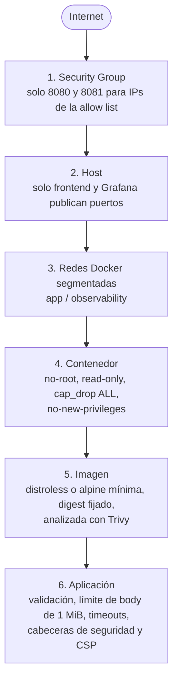
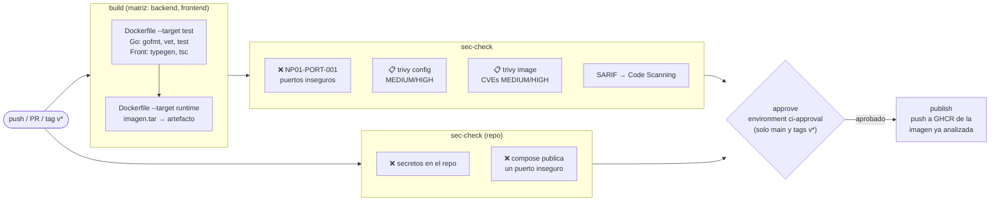
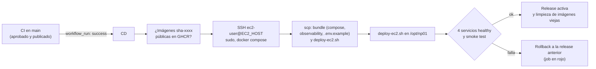

# new-project-01 — Products Platform (cloud native)

Aplicación fullstack de productos (CRUD **maestro–detalle**) construida con principios
**cloud native**:

- Servicios contenerizados sobre **golden images** inmutables.
- Configuración declarativa y por entorno.
- Observabilidad basada en las **4 golden signals** de Google.
- Seguridad por defecto en contenedores, red y cadena de suministro.
- Pipeline CI que construye, analiza, aprueba y publica las imágenes.
- Pipeline CD que despliega cada release aprobada en la EC2 por SSH, con rollback automático.

Las decisiones de arquitectura, trade-offs y especificaciones (SDD) están en
[`docs/adrs/01-architecture-init.md`](docs/adrs/01-architecture-init.md).

---

## Índice

1. [Vista general de la arquitectura](#1-vista-general-de-la-arquitectura)
2. [Principios cloud native aplicados](#2-principios-cloud-native-aplicados)
3. [Componentes](#3-componentes)
4. [Backend: arquitectura hexagonal](#4-backend-arquitectura-hexagonal)
5. [Frontend: SPA con Next.js](#5-frontend-spa-con-nextjs)
6. [Flujo de una petición](#6-flujo-de-una-petición)
7. [Observabilidad: golden signals](#7-observabilidad-golden-signals)
8. [Seguridad](#8-seguridad)
9. [Pipeline CI/CD](#9-pipeline-cicd)
10. [Puesta en marcha](#10-puesta-en-marcha)
11. [Configuración](#11-configuración)
12. [API REST](#12-api-rest)
13. [Estructura del repositorio](#13-estructura-del-repositorio)
14. [Stack y versiones](#14-stack-y-versiones)
15. [Limitaciones conocidas y siguientes pasos](#15-limitaciones-conocidas-y-siguientes-pasos)

---

## 1. Vista general de la arquitectura



Solo dos puertos llegan a internet: **8080** (aplicación) y **8081** (Grafana), y ambos
están filtrados por el Security Group. El backend y Prometheus solo existen en las redes
internas del compose.

| Servicio   | Imagen | Puerto en el host | Puerto interno | Red(es) |
|------------|--------|-------------------|----------------|---------|
| frontend   | `frontend/Dockerfile` (golden image) | **8080** | 8080 | `app` |
| grafana    | `grafana/grafana:13.3.2` (digest fijado) | **8081** | 3000 | `observability` |
| backend    | `backend/Dockerfile` (golden image) | — | 8082 | `app` |
| prometheus | `prom/prometheus:v3.16.0` (digest fijado) | — | 9090 | `app`, `observability` |

---

## 2. Principios cloud native aplicados

| Principio | Cómo se aplica |
|-----------|----------------|
| **Contenedores inmutables** | Golden images multi-stage con la imagen base fijada por digest. CI publica en GHCR la misma imagen que analizó, sin volver a construirla. |
| **Configuración externa (12-factor)** | Puertos, credenciales y URLs llegan por variables de entorno y `.env`; nada de esto está en el código. |
| **Infraestructura declarativa** | `docker-compose.yml`, el scrape de Prometheus, y la fuente de datos y el dashboard de Grafana están versionados como código. Grafana arranca sin configuración manual. |
| **Health checks y orden de arranque** | Cada servicio tiene `HEALTHCHECK`, y `depends_on: service_healthy` garantiza que cada uno arranque cuando sus dependencias están listas. |
| **Procesos desechables** | El backend termina de forma ordenada (*graceful shutdown*) al recibir `SIGTERM`. Los contenedores no guardan estado, salvo los volúmenes de métricas. |
| **Observabilidad** | Métricas Prometheus de las 4 golden signals, logs JSON estructurados (`slog`) y dashboard aprovisionado. |
| **Seguridad por defecto** | Contenedores sin root, sistema de archivos de solo lectura, sin *capabilities* (`cap_drop: ALL`) y con `no-new-privileges`. Red segmentada, mínima superficie expuesta y gate de seguridad en CI. |
| **Desacoplamiento por puertos** | Arquitectura hexagonal: la persistencia y el transporte se cambian sin tocar el dominio. |
| **Automatización CI** | Pipeline de build, análisis de seguridad, aprobación y publicación en GitHub Actions. |

---

## 3. Componentes

### Backend — API de productos (Go)

- Go 1.27 con la biblioteca estándar. El router es `net/http.ServeMux` con patrones
  `GET /api/v1/products/{id}`, sin frameworks.
- Arquitectura **Clean + Hexagonal** (ver §4).
- Persistencia **en memoria** detrás del puerto `ProductRepository`.
- Instrumentación con `prometheus/client_golang` y endpoint `/metrics`.
- Imagen `distroless/static-debian13:nonroot` de **~12 MB**, sin shell. El
  `HEALTHCHECK` usa el propio binario (`/api healthcheck`).

### Frontend — SPA (Next.js)

- Next.js 16 + React 19 + TypeScript `strict` + Tailwind CSS 4.
- **Static export**: no hay runtime de Node en producción.
- Servido por `nginx-unprivileged`, que también hace de **reverse proxy** de `/api`
  hacia el backend.
- Imagen de **~61 MB**.

### Prometheus

- Hace scraping de `backend:8082/metrics` cada 15 s.
- Guarda las métricas 7 días en el volumen `prometheus-data`.
- No se publica en el host.

### Grafana

- La fuente de datos Prometheus y el dashboard **"Golden Signals — Products API"** se
  cargan desde archivos al arrancar.
- Sin registro de usuarios ni acceso anónimo.
- Se publica en el puerto **8081**.

---

## 4. Backend: arquitectura hexagonal



**Regla de dependencias:** todas las dependencias apuntan hacia el `domain`.

| Capa | Paquete | Responsabilidad | Depende de |
|------|---------|-----------------|------------|
| Dominio | `internal/domain` | Entidades, invariantes (nombre de 1 a 100 caracteres, precio y stock ≥ 0, SKU obligatorio) y errores de dominio | Nada (solo stdlib) |
| Puertos | `internal/ports` | Interfaces de entrada (`ProductService`) y de salida (`ProductRepository`, `IDGenerator`, `Clock`) | `domain` |
| Aplicación | `internal/app` | Casos de uso: CRUD del producto, alta, edición y baja de detalles, y unicidad global del SKU | `domain`, `ports` |
| Adaptadores | `internal/adapters/*` | HTTP/JSON, persistencia en memoria y métricas | `ports`, `domain` |
| Composición | `cmd/api` | Conecta los adaptadores, configura el servidor y gestiona señales | Todo |

**Modelo de datos:**



Al borrar un producto se borran también sus detalles, y sus SKU quedan libres para
reutilizarse.

---

## 5. Frontend: SPA con Next.js

| Ruta | Vista |
|------|-------|
| `/` | Catálogo de productos |
| `/products/new/` | Alta de producto |
| `/products/view/?id=<uuid>` | Ficha del producto, edición y tabla de detalles |

**Patrones aplicados:**

- **SPA con static export** (`output: "export"`): todas las páginas se generan en el
  build. Como los ids se pasan por query string (`?id=`), no hace falta generar una
  página por producto.
- **HoC (Higher-Order Components):**
  - `withAsyncData(load)(Component)` gestiona la carga de datos y los estados de carga,
    error y reintento.
  - `withErrorBoundary(Component)` aísla los errores de renderizado con una UI de
    respaldo.

  Se combinan así: `withErrorBoundary(withAsyncData(...)(View))`.
- **Lazy loading:** `DetailsTable` se carga con `next/dynamic` en un *chunk* JS aparte
  que solo se descarga al abrir la ficha de un producto.
- **Capa de API única** (`src/lib/api.ts`): llamadas tipadas, `ApiError` y mensajes
  legibles para los errores 400, 404 y 409.
- **Mismo origen:** el navegador llama a `/api/v1`, nginx lo reenvía al backend y no
  hace falta CORS.



---

## 6. Flujo de una petición



---

## 7. Observabilidad: golden signals

| Señal | Métrica | Tipo | Etiquetas |
|-------|---------|------|-----------|
| **Latencia** | `http_request_duration_seconds` | Histogram (1 ms a 5 s) | `method`, `route`, `status` |
| **Tráfico** | `http_requests_total` | Counter | `method`, `route`, `status` |
| **Errores** | `http_requests_total{status=~"5.."}` | Derivada | — |
| **Saturación** | `http_requests_in_flight`, `go_goroutines`, `process_cpu_seconds_total`, `process_resident_memory_bytes` | Gauge / Counter | — |

Decisiones clave:

- La etiqueta `route` usa el **patrón** de la ruta (`/api/v1/products/{id}`), nunca el
  path real. Así el número de series no crece con cada id distinto.
- `/metrics` y `/healthz` no se instrumentan, para no distorsionar las señales.
- Las rutas que no existen se agrupan en `route="unmatched"`.

**Dashboard aprovisionado** (`observability/grafana/dashboards/golden-signals.json`):

- **Resumen:** RPS, latencia p95, tasa de error 5xx y peticiones en vuelo.
- **Latencia:** p50, p95 y p99, y p95 por ruta.
- **Tráfico y errores:** RPS por ruta y respuestas por código HTTP.
- **Saturación:** peticiones en vuelo, goroutines, CPU y memoria.

---

## 8. Seguridad

### Defensa en profundidad



| Capa | Medidas |
|------|---------|
| Red | Solo se publican 8080 y 8081. Backend (8082) y Prometheus (9090) son internos. Grafana no comparte red con el backend. |
| Contenedores | `USER` no-root en todas las imágenes, `read_only: true` (backend, frontend y Prometheus), `cap_drop: [ALL]` y `no-new-privileges:true`. |
| Imágenes | Multi-stage, sin herramientas de build en el runtime. El backend es distroless y no tiene shell. Bases fijadas por `sha256`. |
| nginx | `server_tokens off`, `X-Content-Type-Options`, `X-Frame-Options: DENY`, `Referrer-Policy` y `Content-Security-Policy`. Las rutas inexistentes devuelven 404 real. |
| Backend | `ReadHeaderTimeout`, `ReadTimeout`, `WriteTimeout`, `MaxBytesReader` de 1 MiB, rechazo de campos JSON desconocidos y errores internos que no filtran detalles. |
| Grafana | Contraseña de admin desde `.env` (ignorado por git), sin registro de usuarios ni acceso anónimo, sin telemetría externa. |
| Secretos | `.env` está fuera de git y CI busca secretos en el repo. |
| Cadena de suministro | Actions fijadas por SHA, Trivy ejecutado desde su imagen fijada por digest y permisos mínimos por job. |

### Política de puertos inseguros (`NP01-PORT-001`)

La política Rego [`.trivy/policies/insecure_ports.rego`](.trivy/policies/insecure_ports.rego)
bloquea cualquier Dockerfile que exponga (`EXPOSE`) alguno de estos puertos. También
detecta rangos como `EXPOSE 100-200`.

| Puerto | Protocolo |
|--------|-----------|
| 21 | FTP |
| 22 | SSH |
| 23 | Telnet |
| 135 | MS-RPC |
| 137-139 | NetBIOS |
| 445 | SMB |
| 2375 | Docker API sin TLS |
| 3389 | RDP |
| 5900 | VNC |

La misma lista está en `INSECURE_PORTS` del workflow, que impide que el compose
**publique** esos puertos.

---

## 9. Pipeline CI/CD

Workflow: [`.github/workflows/ci.yml`](.github/workflows/ci.yml)



❌ = bloquea el pipeline · 📋 = solo informe (reglas ligeras a modo de demostración)

| Evento | build | sec-check | approve | publish |
|--------|:-----:|:---------:|:-------:|:-------:|
| Push a `develop` | ✅ | ✅ | ⏭️ | ⏭️ |
| Pull request | ✅ | ✅ | ⏭️ | ⏭️ |
| Push/merge a `main` | ✅ | ✅ | ⏸️ espera aprobación | ✅ `sha-<commit>` |
| Tag `vX.Y.Z` | ✅ | ✅ | ⏸️ espera aprobación | ✅ `sha-<commit>` y `X.Y.Z` |

Las imágenes se publican en `ghcr.io/andresm98/new-project-01/{backend,frontend}`.

**Flujo de ramas recomendado:** push a `develop`, PR de `develop` a `main`, merge,
aprobación y publicación.

**Configuración necesaria en GitHub (una vez):**

1. *Settings → Environments → New environment* `ci-approval` → *Required reviewers*.
   Si el environment no existe, GitHub lo crea automáticamente **sin protección** y la
   publicación no esperará aprobación.
2. (Recomendado) *Settings → Branches*: proteger `main` exigiendo que `build` y
   `sec-check` pasen.

**Demostrar el gate:** abre un PR que añada `EXPOSE 139` a `backend/Dockerfile`. El job
`sec-check (backend)` fallará con una anotación sobre el Dockerfile.

### CD: despliegue en la EC2

Workflow: [`.github/workflows/cd.yml`](.github/workflows/cd.yml) · script en el host:
[`deploy/deploy-ec2.sh`](deploy/deploy-ec2.sh)



1. Se dispara cuando **CI termina con éxito en `main`**: aprobado en `ci-approval` y
   publicado en GHCR. Los push a `develop`, los PR y los tags no despliegan.
2. Comprueba que las imágenes `sha-<commit>` se pueden descargar sin login (paquetes
   GHCR **públicos**).
3. Se conecta por SSH como `ec2-user` y comprueba que tiene `sudo` sin contraseña y que
   Docker Compose está instalado.
4. Copia el bundle y ejecuta `deploy-ec2.sh` en `/opt/np01`:
   - Fija las imágenes en `release.env` y guarda la anterior en `release.env.prev`.
   - Ejecuta `docker compose pull` y `up -d`, espera a que los 4 servicios estén
     `healthy` y comprueba `/healthz` y `/api/v1/products`.
   - Si algo falla, **vuelve a la release anterior** y el job termina con error.
   - Borra las imágenes `np01` antiguas, conservando la actual y la anterior. Nunca toca
     otros stacks de la VM.
5. El `.env` de producción vive en la VM: CD **nunca lo sobrescribe**. Si no existe, lo
   crea desde `.env.example` con una contraseña de Grafana aleatoria.

**Configuración en GitHub:**

| Tipo | Nombre | Valor |
|------|--------|-------|
| Variable | `EC2_HOST` | IP o DNS público de la EC2 |
| Secret | `AWS_SSH_PRIVATE_KEY` | Clave privada PEM cuya pública está en `~ec2-user/.ssh/authorized_keys` |

**Requisitos:**
- El Security Group debe permitir el puerto 22 desde los runners de GitHub Actions.
- Tras el primer `publish`, marca los paquetes `backend` y `frontend` de GHCR como
  públicos.

---

## 10. Puesta en marcha

**Requisitos:** Docker con Compose v2. No hace falta instalar Go ni Node: todo se
compila y se prueba dentro de contenedores.

```bash
# 1. Configuración
cp .env.example .env            # define GRAFANA_ADMIN_PASSWORD

# 2. Golden images
docker build -t np01-backend:dev  backend
docker build -t np01-frontend:dev frontend

# 3. Arranque
docker compose up -d --no-build
docker compose ps               # los 4 servicios deben estar "healthy"
```

> `docker compose build` requiere buildx ≥ 0.17. Si tu entorno tiene una versión
> anterior, usa `docker build` como arriba.

| Acceso | URL |
|--------|-----|
| Aplicación | `http://<host>:8080` |
| Grafana | `http://<host>:8081` (usuario y contraseña de `.env`) |

Para acceder desde internet, el Security Group debe permitir **8080** y **8081**
únicamente a las IPs de la allow list.

> En la EC2, el stack desplegado por CD vive en **`/opt/np01`** (proyecto Compose `np01`).
> Para operarlo a mano:
> `cd /opt/np01 && sudo docker compose --env-file .env --env-file release.env ps`

### Tests

Se ejecutan en la etapa `test` de cada Dockerfile, igual que en CI:

```bash
docker build --target test backend    # gofmt + go vet + go test -cover
docker build --target test frontend   # next typegen + tsc --noEmit
```

Cobertura actual del backend: `domain` 100 %, `app` 93 %, `adapters/http` 94 % y
`adapters/memory` 92 %.

### Operación

```bash
docker compose logs -f backend          # logs JSON estructurados
docker compose restart frontend
docker compose down                     # detiene y conserva los volúmenes de métricas
docker compose down -v                  # detiene y borra también los volúmenes
```

---

## 11. Configuración

| Variable | Dónde | Por defecto | Descripción |
|----------|-------|-------------|-------------|
| `GRAFANA_ADMIN_USER` | `.env` | `admin` | Usuario admin de Grafana |
| `GRAFANA_ADMIN_PASSWORD` | `.env` | — (**obligatoria**) | Contraseña admin. Grafana solo la aplica en el primer arranque. |
| `PORT` | backend (runtime) | `8082` | Puerto de escucha de la API |
| `CORS_ALLOWED_ORIGIN` | backend (runtime) | vacío (CORS desactivado) | Solo hace falta si el frontend no usa el proxy |
| `NEXT_PUBLIC_API_URL` | frontend (build arg) | `/api/v1` | URL base de la API |
| `NEXT_PUBLIC_GRAFANA_PASSWORD` | frontend (build arg) | vacío | Si se define, el pie de página muestra la contraseña de Grafana. **Solo para builds locales**: CI no la define. |

Para reconstruir el frontend con la contraseña de Grafana en el pie de página:

```bash
set -a; . ./.env; set +a
docker build -t np01-frontend:dev --build-arg NEXT_PUBLIC_GRAFANA_PASSWORD="$GRAFANA_ADMIN_PASSWORD" frontend
docker compose up -d --no-build frontend
```

> ⚠️ Esto expone la contraseña de **admin** de Grafana a cualquier visitante del
> frontend.

---

## 12. API REST

Base: `/api/v1` (a través de `http://<host>:8080`).

| Método | Ruta | Éxito | Errores |
|--------|------|-------|---------|
| GET | `/products` | 200 lista | — |
| POST | `/products` | 201 | 400 |
| GET | `/products/{id}` | 200 (incluye `details`) | 404 |
| PUT | `/products/{id}` | 200 | 400, 404 |
| DELETE | `/products/{id}` | 204 (borra también los detalles) | 404 |
| POST | `/products/{id}/details` | 201 | 400, 404, 409 (SKU duplicado) |
| PUT | `/products/{id}/details/{detailId}` | 200 | 400, 404, 409 |
| DELETE | `/products/{id}/details/{detailId}` | 204 | 404 |

Endpoints internos del backend, que no pasan por el proxy: `GET /healthz` y
`GET /metrics`.

Formato de error:

```json
{ "error": { "code": "validation_error", "message": "name is required" } }
```

Códigos posibles: `validation_error`, `invalid_body`, `not_found`, `duplicate_sku` e
`internal_error`.

Ejemplo:

```bash
curl -s -X POST http://localhost:8080/api/v1/products \
  -H 'Content-Type: application/json' \
  -d '{"name":"Laptop","description":"14 pulgadas"}'

curl -s -X POST http://localhost:8080/api/v1/products/<id>/details \
  -H 'Content-Type: application/json' \
  -d '{"sku":"LP-14","price":999.9,"stock":5}'
```

---

## 13. Estructura del repositorio

```
.
├── backend/                          # Golden image 1: API Go
│   ├── cmd/api/main.go               #   composition root, graceful shutdown, healthcheck
│   ├── internal/
│   │   ├── domain/                   #   entidades, invariantes y errores
│   │   ├── ports/                    #   interfaces de entrada y salida
│   │   ├── app/                      #   casos de uso
│   │   └── adapters/
│   │       ├── http/                 #   REST, DTOs, CORS y router
│   │       ├── memory/               #   repositorio en memoria
│   │       └── metrics/              #   golden signals (Prometheus)
│   └── Dockerfile                    #   etapas base, test, build y runtime (distroless)
├── frontend/                         # Golden image 2: SPA Next.js
│   ├── src/
│   │   ├── app/                      #   rutas (/, /products/new, /products/view)
│   │   ├── components/               #   formularios, tabla lazy, footer, etc.
│   │   ├── hoc/                      #   withAsyncData, withErrorBoundary
│   │   └── lib/                      #   cliente de la API y tipos
│   ├── nginx.conf                    #   SPA, proxy /api, cabeceras de seguridad
│   └── Dockerfile                    #   etapas deps, test, build y runtime (nginx-unprivileged)
├── observability/
│   ├── prometheus/prometheus.yml     # configuración de scraping
│   └── grafana/
│       ├── provisioning/             # fuente de datos y proveedor de dashboards
│       └── dashboards/               # golden-signals.json
├── .github/workflows/ci.yml          # build, sec-check, approve y publish
├── .github/workflows/cd.yml          # deploy a la EC2 por SSH tras CI en main
├── deploy/deploy-ec2.sh              # despliegue, healthchecks, smoke test y rollback
├── .trivy/policies/                  # política Rego NP01-PORT-001
├── .trivyignore                      # excepciones justificadas (vacío)
├── docker-compose.yml                # 4 servicios, 2 redes, 2 volúmenes
├── .env.example                      # plantilla de configuración
└── docs/adrs/                        # ADR y especificaciones (SDD)
```

---

## 14. Stack y versiones

| Ámbito | Tecnología |
|--------|-----------|
| Backend | Go 1.27, `net/http`, `prometheus/client_golang` 1.25, `google/uuid` 1.6 |
| Frontend | Next.js 16.4, React 19.3, TypeScript 6.0, Tailwind CSS 4.3 |
| Imágenes base | `golang:1.27-alpine`, `node:26-alpine`, `distroless/static-debian13:nonroot`, `nginx-unprivileged:stable-alpine` (todas fijadas por digest) |
| Observabilidad | Prometheus 3.16, Grafana 13.3 |
| Orquestación | Docker Compose v2 |
| CI/CD | GitHub Actions, Trivy 0.76, GHCR, SSH a EC2 |

---

## 15. Limitaciones conocidas y siguientes pasos

| Limitación actual | Siguiente paso sugerido |
|-------------------|-------------------------|
| Persistencia en memoria: los datos se pierden al reiniciar | Adaptador PostgreSQL que implemente `ProductRepository`, sin cambios en el dominio |
| HTTP sin TLS | Reverse proxy con TLS (Caddy o Traefik con Let's Encrypt), o un load balancer del proveedor cloud |
| Un solo host con Compose | Llevar los servicios a Kubernetes o ECS: las imágenes, health checks y configuración ya son compatibles |
| CI ligero: las CVEs no bloquean | Volver a bloquear en HIGH/CRITICAL con `--ignore-unfixed` y un `.trivyignore` justificado |
| CD por SSH, con el puerto 22 abierto a los runners | AWS SSM + OIDC (sin puerto 22 ni claves en GitHub) |
| Cada despliegue reinicia el backend y borra los datos en memoria | Persistencia real (ver primera fila) |
| Las imágenes de GHCR no llevan la contraseña de Grafana en el pie de página | Inyectar la configuración al arrancar el contenedor |
| Grafana con el usuario admin compartido | Usuarios de solo lectura y SSO |
| Solo métricas | Añadir trazas (OpenTelemetry) y agregación de logs (Loki) |
